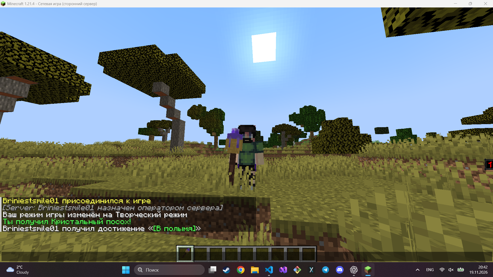
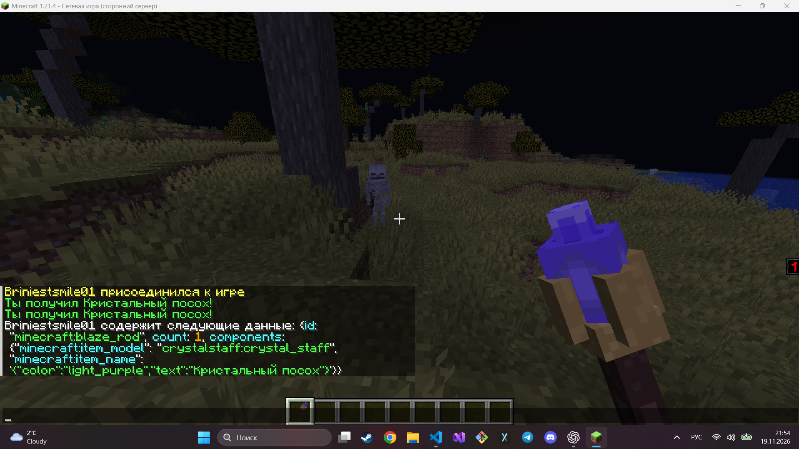

# 💎 CrystalStaff

<p align="center">
  
</p>

A custom magic staff plugin for Minecraft servers, built with Java 21 and Paper API.

CrystalStaff introduces a unique 3D magical weapon with animated crystal effects, area knockback, and a cooldown system.

> **Project status:** Playable prototype / active development  
> **Current version:** 1.0.0-SNAPSHOT  
> **Minecraft version:** 1.21.4

**CrystalStaff** is a Paper plugin that adds a magical 3D staff with a purple crystal, a radial knockback spell, an expanding particle shockwave, and a short cooldown. The model is supplied as a separate Minecraft resource pack, included in this repository.

## ✨ Features

### 💎 Custom 3D Crystal Staff
- Unique 3D item model created in Blockbench.
- Custom textures and resource pack support.
- Purple crystal design with golden details.
- Custom item identification using Persistent Data Containers.

### ⚡ Crystal Blast
- Activate the staff by right-clicking.
- Release a burst of magical particles.
- Knock back hostile mobs within a five-block radius.
- Animated, expanding purple shockwave.
- Additional visual and sound effects.
- The current version does **not** deal direct damage.

### ⏳ Cooldown System
- Five-second cooldown after each activation.
- Action bar notification when the ability is recharging.
- Prevents repeated ability activation during cooldown.

### 🛠 Technical Features
- Built with Java 21.
- Powered by Paper API.
- Modern Brigadier command registration.
- Adventure MiniMessage integration.
- Event-driven ability handling.
- Modular Java package structure.

## 🎮 Commands

| Command | Description | Permission |
|---------|-------------|------------|
| `/crystalstaff give` | Gives the player a Crystal Staff | `crystalstaff.give` |

## 📦 Requirements

- Minecraft Java Edition 1.21.4
- Paper 1.21.4
- Java 21
- [CrystalStaff resource pack](downloads/CrystalStaff-ResourcePack-1.21.4.zip) for the custom 3D model

## 🚀 Installation

1. Download the plugin JAR from a release, or [build it from source](#-building-from-source).
2. Place the JAR file into your Paper server's `plugins` directory.
3. Restart the Minecraft server.
4. Download [CrystalStaff-ResourcePack-1.21.4.zip](downloads/CrystalStaff-ResourcePack-1.21.4.zip). **Do not unzip it** for normal client installation.
5. In Minecraft, open **Options → Resource Packs → Open Pack Folder**, put the resource-pack ZIP there, and enable it.
6. Join the server with an account that has the required permission (operators have it by default).
7. Run:

   `/crystalstaff give`

8. Hold the staff and right-click to activate Crystal Blast.

The resource pack provides the **appearance** of the item; the plugin JAR provides its **gameplay behavior**. Both are required for the intended experience. The editable pack source is available in [`resource-pack/`](resource-pack/).

## 🔨 Building from Source

Clone or download this repository, navigate to its root directory, and build using Maven and JDK 21:

```bash
mvn clean package
```

The compiled JAR will be available at `target/crystalstaff-1.0.0-SNAPSHOT.jar`. Maven downloads the Paper API dependency; it is not bundled into the plugin JAR.

## 🧩 Project Structure

```text
CrystalStaffPlugin/
├── .gitattributes
├── .gitignore
├── CHANGELOG.md
├── README.md
├── pom.xml
├── downloads/
│   └── CrystalStaff-ResourcePack-1.21.4.zip
├── resource-pack/
│   ├── pack.mcmeta
│   └── assets/crystalstaff/
├── docs/
│   └── screenshots/
├── src/
│   └── main/
│       ├── java/
│       │   └── me/aiderlirk/crystalstaff/
│       │       ├── CrystalStaffPlugin.java
│       │       ├── ability/
│       │       │   ├── CrystalBlastListener.java
│       │       │   └── CrystalShockwave.java
│       │       ├── command/
│       │       │   └── CrystalStaffCommand.java
│       │       └── item/
│       │           └── CrystalStaffItem.java
│       └── resources/
│           └── plugin.yml
```

## 🖼 Screenshots

| Custom 3D staff | Staff in first person |
|:---:|:---:|
|  |  |

| Crystal Blast | Expanding Shockwave |
|:---:|:---:|
|  |  |

**Cooldown feedback:** [View in-game screenshot](docs/screenshots/cooldown.png).

## 🗺 Future Updates

The following features are planned for future versions and are **not yet implemented**.

### ⚔ Combat Improvements
- [ ] Configurable ability damage.
- [ ] Improved knockback mechanics.
- [ ] Additional combat effects.
- [ ] Better balancing for survival gameplay.

### 🔮 New Magic Abilities
- [ ] Crystal Beam — a focused magical attack.
- [ ] Crystal Shield — temporary defensive protection.
- [ ] Crystal Teleport — short-distance magical movement.
- [ ] Additional area-of-effect spells.
- [ ] Ability selection system.

### 💜 Mana System
- [ ] Mana consumption for abilities.
- [ ] Mana regeneration.
- [ ] Visual mana indicator.
- [ ] Customizable mana costs.

### ⚙ Configuration
- [ ] `config.yml` support.
- [ ] Configurable cooldowns.
- [ ] Adjustable damage and knockback.
- [ ] Particle and sound settings.
- [ ] Ability enable/disable options.

### 🎨 Visual Improvements
- [ ] New particle animations.
- [ ] Additional staff models.
- [ ] Enhanced spell effects.
- [ ] Improved visual feedback.

### 🌍 General Improvements
- [ ] Custom crafting recipe.
- [ ] Multiple language support.
- [ ] More staff variants.
- [ ] Performance optimizations.
- [ ] Expanded documentation.

> This roadmap represents development goals and may change as the project evolves.

## 🧰 Technologies

- Java 21
- Paper API
- Apache Maven
- Adventure API / MiniMessage
- Brigadier
- Blockbench
- Minecraft Resource Packs

## 👨‍💻 Development

CrystalStaff is an independent Minecraft plugin development project focused on custom items, interactive abilities, clean code organization, and modern Paper API features.

The project is actively being developed, with additional gameplay mechanics and customization options planned for future releases.

## 📄 License

No open-source license has been selected for this project yet. Please contact the author before reusing or redistributing the code or artwork.
